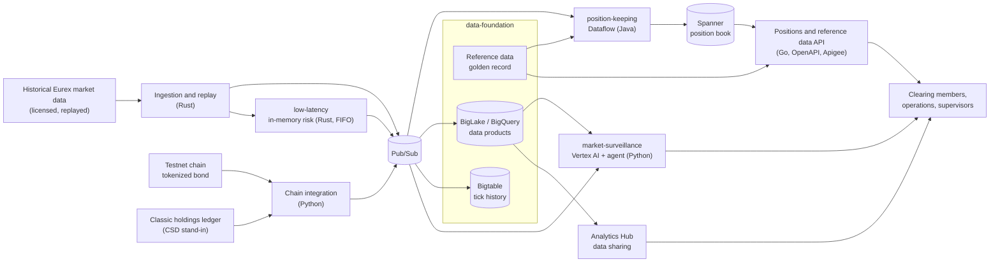

# GCP FMI Eurex Platform

A reference platform for **Financial Market Infrastructures (FMIs)** on Google Cloud: scalable real-time position keeping, a low-latency in-memory hot path, the lifecycle of a tokenized and hybrid bond, and explainable market surveillance, built on one shared data foundation.

> **Status: in progress.** Independent reference implementation, not affiliated with Google, Eurex or Deutsche Börse. Clearing members and accounts are fictitious, smart contracts run on a testnet only, and nothing here is meant for production use.

## Why this exists

Exchanges, CCPs and CSDs are moving core processes to the cloud while the industry shortens settlement cycles (the EU move to T+1 is planned for October 2027) and starts to tokenize assets. Both push batch-era post-trade processing towards real time.

This repository shows what that can look like on Google Cloud across the whole trade lifecycle, with the regulatory and operational rigor the industry requires: data residency, customer-managed encryption, operational resilience under DORA, and explainable AI.

## Components

| Component | What it shows | Key services | Status |
| --- | --- | --- | --- |
| [`00_platform`](00_platform/) | Landing zone, security baseline, CI/CD templates shared by all components | Terraform, VPC Service Controls, CMEK, Cloud Deploy | Scaffolded |
| [`01_data-foundation`](01_data-foundation/) | Reference data golden record, market data products, data sharing without copies, contract-first APIs | Pub/Sub, BigLake, BigQuery, Bigtable, Analytics Hub, Apigee | Planned |
| [`02_position-keeping`](02_position-keeping/) | Scalable real-time positions across tokenized, detokenized and hybrid instruments, intraday risk and margin for futures and options, tokenized collateral, DORA resilience | Pub/Sub, Dataflow, Spanner, BigQuery | PRD drafted |
| [`03_tokenized-bond`](03_tokenized-bond/) | Issuance, tokenization and detokenization, DvP settlement, custody and lifecycle events of a hybrid bond | Solidity (testnet), Cloud KMS / Cloud HSM, Pub/Sub | Planned |
| [`04_market-surveillance`](04_market-surveillance/) | Spoofing detection on the order book with explainable alerts and an investigation agent | Vertex AI, Gemini, Agent Development Kit, BigQuery | Planned |
| [`05_low-latency`](05_low-latency/) | In-memory hot path with feed handler, pre-trade risk check and order gateway, latency benchmark ladder, cloud and co-location boundary | Rust, C3 / C4, compact placement, kernel bypass, Pub/Sub | Planned |

## Architecture



## Trade lifecycle coverage

| Stage | Where it is shown |
| --- | --- |
| Issuance | `03_tokenized-bond`: issuance via smart contract, investor whitelist |
| Trading | `01_data-foundation`: market data replay; `05_low-latency`: feed handler, pre-trade risk check, order gateway; `04_market-surveillance`: order book surveillance |
| Clearing | `02_position-keeping`: CCP view, margin calls, futures and options margin |
| Settlement | `03_tokenized-bond`: delivery versus payment; `02_position-keeping`: daily cash settlement of variation margin |
| Custody | `03_tokenized-bond`: custody with keys in Cloud KMS / Cloud HSM, coupon and redemption, tokenization and detokenization against the classic register |
| Reference and market data | `01_data-foundation`: golden record (ISIN, LEI, CFI, FIGI), market data products, data sharing |

## Engineering principles

- **Trunk-based development:** short-lived branches, CI on every push, blue/green deployments.
- **Polyglot by purpose:** Python for agents, analytics and integration; Java for Dataflow (Apache Beam); Go for APIs; Rust for market data ingestion and the low-latency hot path; Solidity for smart contracts.
- **Contract-first:** OpenAPI contracts with contract tests, published through Apigee.
- **No database in the hot path:** latency-critical state lives in memory; databases hold the authoritative record and are updated asynchronously.
- **Event-sourced positions:** an immutable event log, idempotent consumers, reproducible historical states.
- **Secure by default:** EU region `europe-west3` (Frankfurt), customer-managed encryption keys, VPC Service Controls, least-privilege IAM.
- **Built to hand over:** every component ships with a PRD, an architecture diagram and a hand-off guide.

Details: [docs/engineering-standards.md](docs/engineering-standards.md), the [architecture decision records](docs/adr/) the [low-latency playbook](docs/low-latency-playbook.md) and the [industry insights](docs/industry-insights.md) that keep each component close to how exchanges, CCPs and CSDs actually build.

## Regulatory context

The components are designed with these frameworks in mind: DORA, EMIR, CSDR, MiFID II / MiFIR, MAR, the EU AI Act, the EU DLT Pilot Regime, the German eWpG and the CPMI-IOSCO Principles for Financial Market Infrastructures. This is an engineering illustration, not legal or regulatory advice.

## Data

Market data comes from licensed historical Eurex data and is **not** part of this repository. The repository contains fetch and replay scripts and small synthetic samples only.

## Repository layout

```
gcp-fmi-eurex-platform/
├── 00_platform/              # Terraform, security baseline, CI/CD templates
├── 01_data-foundation/       # reference and market data, data products, APIs
├── 02_position-keeping/      # real-time positions, risk, margin, DORA
├── 03_tokenized-bond/        # hybrid issuance, DvP, custody, lifecycle events
├── 04_market-surveillance/   # spoofing detection, explainable alerts, agent
├── 05_low-latency/           # in-memory hot path, latency benchmark
└── docs/                     # PRDs, architecture decisions, engineering standards
```

## Roadmap

- [ ] `01_data-foundation` and `02_position-keeping` MVP: December 2026
- [ ] `03_tokenized-bond`, `04_market-surveillance` and `05_low-latency` MVP: January 2027
- [ ] Data foundation extensions and security hardening: February–March 2027

## License

[Apache License 2.0](LICENSE)

Maintained by [@bperunx](https://github.com/bperunx).
